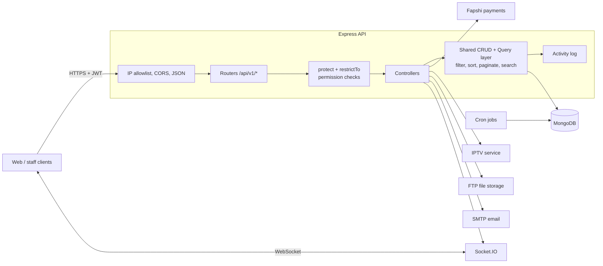

# Atlantic Pearl Hotel API

A REST and real-time backend for running a full hotel and resort: reservations, rooms, billing, restaurant, parking, inventory, HR, and role-based dashboards, all in one TypeScript service.

[](https://github.com/SMXKY/Atlantic-Pearl-Hotel-API/actions/workflows/ci.yml)


---

## Overview

Hotels usually run on several disconnected tools: one for bookings, one for the restaurant till, a spreadsheet for stock, another for staff. This API puts those operations behind one backend with a shared user model, a shared permission system, and one audit trail.

> Built for Atlantic Pearl Hotel & Resort and shared with the client's permission. This repository is a development snapshot, not the deployed production system.

**Scale of the codebase:**

| | |
|---|---|
| Business modules | 10 (Reservations, Properties, Finance, Restaurant, Parking, Inventory, HR, Auth, Notifications, Content) |
| Data models | 70+ Mongoose schemas |
| Route groups | 60+ under `/api/v1` |
| Background jobs | 4 scheduled cron jobs |
| External integrations | Payment gateway, IPTV, FTP storage, Google OAuth, SMTP email |

## Key features

### Reservations and rooms
- Online and front-desk (manual) reservations, with room availability checked in middleware before a booking is written
- Before and after snapshots whenever a guest's rooms change, plus a full status-change history for every reservation
- Booking calendar, KPIs, and guest self-service portal (`/reservations/my-reservations`)
- Rooms released automatically by a cron job when reservations expire or end
- Buildings, room types, bed types, amenities, rates, and guest reviews

### Finance
- Invoices, bills, bill items, taxes, and discounts
- PDF invoices and receipts generated server-side with `pdfmake`
- Online deposits through the Fapshi mobile-money payment API, with a payment redirect callback

### Restaurant and parking
- Menu items, categories, meal combos, carts, and orders
- Parking sections, section types, spots, and parking reservations

### Inventory and procurement
- Items, categories, locations, and stock per location
- Stock movements, requisitions, purchase orders, goods receipts, and supplier payments
- Supplier ratings, budgets, and financial events
- Scheduled stock-takes, low-stock alert rules, and an overdue purchase-order checker

### Security and access control
- JWT authentication plus Google OAuth sign-in
- Email verification, password reset codes, and account lockout after repeated failed logins
- **Permission-based access control**: roles carry permissions, and per-user permission and role overrides can grant or revoke individual permissions without creating new roles
- Every create, update, and delete through the shared CRUD layer is recorded in an activity log with the before and after document
- IP allowlisting on HTTP and WebSocket connections, and rate limiting on search

### Real-time and reporting
- Socket.IO notifications pushed to per-user rooms
- Role-specific dashboards (finance, HR, inventory, parking, restaurant) and global search

## Tech stack

| Layer | Tools |
|---|---|
| Language and runtime | TypeScript (strict mode), Node.js |
| Web framework | Express 5 |
| Database | MongoDB with Mongoose |
| Real-time | Socket.IO |
| Auth | JSON Web Tokens, bcrypt, Google Auth Library |
| Validation | Mongoose validators, `validator`, `libphonenumber-js`, Joi |
| Documents and email | pdfmake, Nodemailer with HTML templates |
| Scheduling | node-cron |
| File uploads | Multer, FTP storage in production, local disk in development |
| API docs | swagger-jsdoc and swagger-ui-express |

## Architecture



**Request flow.** Each route is protected by two middlewares. `protect` verifies the JWT and loads the user with their role. `restrictTo(...permissions)` then checks the user's resolved permissions (role permissions plus overrides) against the permission constants in `src/types/Permissions.type.ts`.

**Shared CRUD layer.** Most controllers delegate to `src/util/Crud.util.ts`, which handles create, read, update, and delete in one place and writes the activity log. `src/util/Query.util.ts` turns query strings into MongoDB queries, so every list endpoint supports the same filtering, sorting, field selection, pagination, and search:

```http
GET /api/v1/rooms?price[gte]=20000&status[in]=available,cleaning&sort=-price&fields=number,price&page=2&limit=20
```

**Errors.** Controllers are wrapped in `catchAsync` and throw `AppError` with an HTTP status. A global error controller formats the response: detailed errors and stack traces in development, safe messages in production.

## Getting started

### Prerequisites
- Node.js 20 or later
- MongoDB 6 or later (local install or MongoDB Atlas)

### Install and run

```bash
git clone https://github.com/SMXKY/Atlantic-Pearl-Hotel-API.git
cd Atlantic-Pearl-Hotel-API
npm install

cp .env.example .env    # the defaults boot locally; fill in real keys as needed
npm run dev             # starts on http://localhost:3000 with hot reload
```

For a production build:

```bash
npm run build           # compiles to dist/ and copies templates and fonts
npm start
```

On first start the server seeds the default roles, permissions, and documents. If the `SUPER_ADMIN_*` variables are set, it also creates the first super-admin account.

> **Note:** HTTP and WebSocket requests are filtered by an IP allowlist set in `ALLOWED_IPS`. It defaults to localhost, so local development works out of the box.

### Environment variables

All variables are listed in [`.env.example`](.env.example), and its defaults are enough to start the server against a local MongoDB. The FTP, Fapshi, and IPTV values must be non-empty for the server to boot, but the placeholders are fine until you use those features. Google sign-in and email can stay empty.

### Tests

```bash
npm test             # run the test suite once
npm run test:watch   # re-run on file changes
npm run typecheck    # strict TypeScript check without emitting
```

Tests use [Vitest](https://vitest.dev) and cover the query builder (filters, sorting, pagination, search escaping), permission middleware, and error formatting. GitHub Actions runs the type check, the tests, and a production build on every push and pull request.

## API documentation

Interactive Swagger UI is served at:

```
http://localhost:3000/docs
```

All endpoints are versioned under `/api/v1`. Main resource groups:

| Area | Base paths |
|---|---|
| Auth and access | `/auth`, `/users`, `/roles`, `/permissions`, `/role-permissions`, `/permission-overides`, `/role-overides` |
| Reservations | `/reservations`, `/rates` |
| Properties | `/buildings`, `/rooms`, `/room-types`, `/bed-types`, `/amenities`, `/room-type-reveiws` |
| Finance | `/invoices`, `/bills`, `/bill-items`, `/taxes`, `/discounts` |
| Restaurant | `/restaurant-items`, `/restaurant-item-categories`, `/meal-combos`, `/restaurant-carts`, `/restaurant-orders` |
| Parking | `/parking-sections`, `/parking-section-types`, `/parking-spots`, `/parking-reservations` |
| Inventory | `/inventory/items`, `/inventory/suppliers`, `/inventory/purchase-orders`, `/inventory/stock-takes`, and more |
| HR | `/employees`, `/guests`, `/departments`, `/positions`, `/stations` |
| Platform | `/notifications`, `/activity-logs`, `/content`, `/admin-configurations` |

## Project structure

```
src/
├── index.ts            # Entry point: DB connection, cron jobs, HTTP server
├── app.ts              # Express app: middleware, route mounting, Swagger
├── socket.ts           # Socket.IO server, attached to HTTP in index.ts
├── routes/             # Express routers, grouped by business module
├── controllers/        # Request handlers, grouped by business module
├── models/             # Mongoose schemas, hooks, and validation
├── middlewares/        # Room availability, file handling, created-by tracking
├── services/           # External APIs: payments, IPTV, FTP
├── cron-jobs/          # Scheduled background tasks
├── defaults/           # Seed data: roles, permissions, super admin
├── util/               # Shared CRUD, query builder, errors, email, PDF helpers
├── templates/          # HTML email and invoice templates
├── types/              # Shared TypeScript types and permission constants
└── fonts/              # Fonts embedded in generated PDFs
tests/                  # Vitest unit tests
algorithms/             # Design notes written before implementing features
```

## Design decisions

- **Permissions, not role names.** Routes check fine-grained permissions such as `can_cancel_reservation` instead of roles like "manager". Hotels can define their own roles, and one employee can receive an extra permission through an override without a new role being created.
- **One CRUD and query layer.** With 60+ resources, putting create, read, update, delete, pagination, and audit logging in one class keeps behaviour consistent and makes a new resource mostly a model and a router.
- **Auditable reservation changes.** Moving a guest to different rooms saves the reservation's full state before and after the change, and every status change is stored as its own record. Disputes about a booking can be traced step by step.
- **Socket server decoupled from startup.** Models emit real-time events, so the Socket.IO instance lives in its own module and is attached to the HTTP server at boot. Importing a model (in a test, for example) never starts the server or connects to the database.
- **Logic in Mongoose hooks.** Reservation pricing, status transitions, and side effects such as IPTV activation run in pre and post save and update hooks, so they apply the same way whether a booking comes from a guest or the front desk.

## Roadmap

- Integration tests for reservation pricing and room availability against an in-memory MongoDB
- Make the FTP, payment, and IPTV integrations optional at startup
- Restrict CORS origins through environment variables
- Docker Compose setup for one-command local start

## Author

Built by [@SMXKY](https://github.com/SMXKY).
